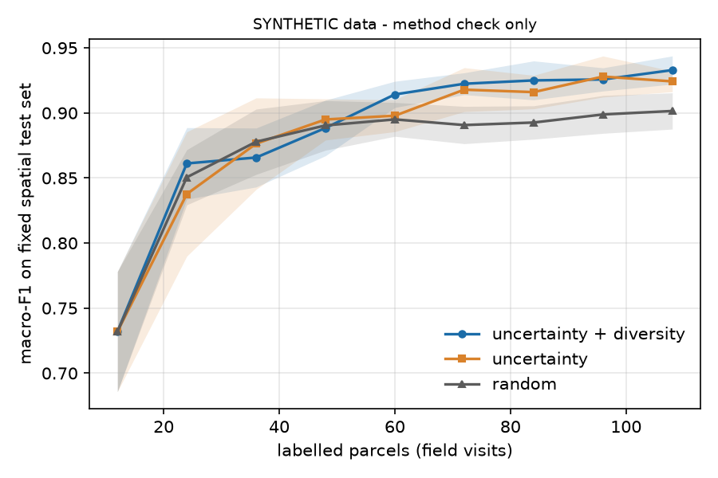

# Active learning: field campaigns that teach the model

`geocrop fieldwork` ranks parcels by how uncertain the model is about them. `geocrop active-learning` closes the
loop around that ranking: choose a *batch* of parcels for the next field trip, merge what the field team (or an
analyst) recorded back into the training data with full provenance, retrain, and repeat. A simulation mode
answers the question a paper or a budget holder asks first: *how many labelled parcels does each sampling strategy
need for a given accuracy?*

```
 geocrop parcels ──► active-learning select ──► field visits / analyst review ──► active-learning ingest
       ▲                (uncertain, diverse,        (label form CSV)              (provenance, conflicts,
       │                 spread, by trip)                                           validation kept apart)
       └──────── geocrop samples / train / predict ◄──────────── updated training polygons ◄──┘
```

## 1. Select a batch: `geocrop active-learning select`

```bash
geocrop active-learning select --parcels outputs/parcels/parcels.gpkg --out campaign/round1/select.gpkg \
    --budget 40 --min-spacing-m 1000 --trips 4 --training data/reference/training.gpkg \
    --exclude data/reference/observations.gpkg --round 1
```

How the batch is built (`geocrop.active_learning.select`):

1. **Priority** – the `fieldwork` score: normalised entropy of the parcel's mean class probabilities, +0.5 when
   the conformal prediction set holds more than one class, + share of pixels outside the area of applicability.
2. **Candidates** – the `candidate_factor × budget` (default 3×) highest-priority parcels that are not already in
   the training set (`--training`) and not excluded (`--exclude`: validation sites, inaccessible fields).
3. **Diversity** – k-center greedy (Sener & Savarese, 2018) in a standardised feature space: each step takes the
   candidate farthest from everything already labelled *or* already selected, blended with its priority
   (`--uncertainty-weight`, 0 = pure diversity, 1 = pure uncertainty). The feature space is the parcel's class
   probability vector `p_*` by default, or any table keyed by parcel id (`--features`, e.g. the per-parcel phenology
   markers of `geocrop markers`). Existing training parcels act as centres, so the
   batch goes where the model has not been taught yet instead of repeating one confusion forty times.
4. **Stratification** – quota per *predicted* class (`--stratify equal|proportional|none`); `equal` keeps rare
   classes from being starved. Quotas are soft: if spacing makes a class quota impossible, the rest of the budget
   is filled without the quota and `quota_relaxed` is reported.
5. **Spatial spread** – no two selected parcels closer than `--min-spacing-m` (choose ≥ the autocorrelation range
   from `geocrop variogram`). Spacing is never relaxed; if fewer parcels qualify, `shortfall` and a hint are
   reported.
6. **Trips** (`--trips N`) – the batch is grouped into N areas (k-means on centroids) and ordered within each
   trip by nearest neighbour; `trip_id`, `trip_order` and a straight-line route length per trip are written.
   Straight-line kilometres between centroids are a planning aid, **not** road distance or travel time.

Outputs: the selected parcels (`al_round`, `al_rank`, `priority`, `feature_distance`, `stratum`, `trip_id`,
`trip_order`), `<out>_summary.json`, and `<out>_label_form.csv` – the form the field team fills in.

## 2. Record labels

One row per observation or analyst decision (CSV, GeoPackage or Parquet):

| column | meaning |
|---|---|
| `parcel_id` | parcel identifier (`--id-field`) |
| `label` | observed class; empty, `unknown` or `cant_tell` = no label (recorded, not used) |
| `source` | `field`, `analyst`, `farmer_photo`, … (free text, kept in provenance) |
| `date` | observation date (ISO 8601) |
| `confidence` | observer confidence 0–1 (optional; `--min-confidence` filters) |
| `purpose` | `training` (default) or `validation` |

Analyst decisions from a review interface (agree / disagree / can't tell) fit the same table: write the class the
analyst confirmed or corrected into `label`, `can't tell` leaves it empty, `source=analyst`.
The **Review** view of the web workspace records such decisions and exports this table directly
([web interface](web-interface.md#review-analyst-parcel-decisions)).

## 3. Ingest: `geocrop active-learning ingest`

```bash
geocrop active-learning ingest --labels campaign/round1/labels.csv --parcels outputs/parcels/parcels.gpkg \
    --training data/reference/training.gpkg --out data/reference/training_r1.gpkg --round 1 \
    --validation data/reference/observations.gpkg --min-confidence 0.5
```

Every label row gets an **action** in the provenance log (`al_provenance.csv`, appended per round; a round id can
be ingested only once):

| action | meaning |
|---|---|
| `added` | new training polygon `AL<round>_<parcel_id>` (geometry from the parcel layer, optional `--inner-buffer-m`) |
| `already_labelled` | parcel already in training with the same class |
| `conflict_kept_existing` / `replaced` | new label disagrees with the training label; `--existing-policy keep` (default) or `replace` (previous label logged) |
| `conflict_excluded` | labels for one parcel disagree within the round; `--conflict-policy exclude` (default) or resolved by `highest_confidence`, `latest`, `majority` (unresolved ties stay excluded) |
| `duplicate_in_round` / `overruled` | further rows for a parcel whose label was resolved |
| `validation_reserved` | row with `purpose=validation`: written to `validation_labels_round<k>.csv`, never to training |
| `validation_excluded` | parcel touched by a validation observation (`--validation`, plus `--validation-buffer-m`) |
| `low_confidence`, `no_label`, `unknown_parcel` | not used |

Every disagreement is listed in `ingest_report_round<k>.json` under `conflicts` – these are the parcels worth a
second look. Training polygons carry `al_round` (0 = initial set), `label_source`, `label_date`,
`label_confidence` and `parcel_id`, so every model can be traced back to the round that added each label.

**Validation separation is enforced, not advised.** Parcels hit by validation observations and rows marked
`purpose=validation` never enter the training table, and the ingest *stops* if the existing training set already
overlaps the validation observations. Keep the independent validation sample (see
[classification and validation](classification-validation.md)) out of the active-learning loop entirely:
actively selected parcels are, by construction, *not* a probability sample and must not be used to estimate map
accuracy or area.

Then re-extract samples from the updated polygons and retrain (`geocrop run` with the new `training` path, or
`samples.extract` + `model.train`).

## 4. Simulate label-budget curves: `geocrop active-learning simulate`

```bash
# SYNTHETIC pool (software/method check)
geocrop active-learning simulate --out outputs/al_sim --repeats 10 --test-buffer-m 300
# a real labelled pool: one unit per reference polygon (pixel features averaged)
geocrop active-learning simulate --samples outputs/features/samples.npz --out outputs/al_sim_real \
    --block-m 5000 --test-buffer-m 1000 --initial 20 --batch 20 --rounds 10 --repeats 10
```

Protocol (`geocrop.active_learning.simulate`):

* **Fixed test set** – whole spatial blocks (`--block-m`, class-stratified `StratifiedGroupKFold`, fraction
  `--test-fraction`), drawn once and shared by every strategy and repeat; pool units within `--test-buffer-m` of a
  test unit are removed so no strategy can label a test unit's neighbour.
* **Paired repeats** – each repeat (seed `seed + 1000·r`) draws one initial labelled set (≥ 1 unit per class) used
  by all strategies; the classifier (default RF, 100 trees, balanced class weights; `--params`) is refit each round.
* **Strategies** – `random`; `uncertainty` (top normalised entropy); `uncertainty_diversity` (top
  `candidate_factor × batch` by entropy, then the same k-center selection as `select`, with optional
  `--min-spacing-m` and `--stratify`).
* **Outputs** – `curves.csv` (macro-F1 and OA per strategy/repeat/round), `summary.csv` (mean, SD, 95 % t-interval
  over repeats per budget), `alc.csv` (area under the budget curve per repeat and the *paired* difference to random),
  `simulation.json` (protocol, test-set composition, comparison) and `budget_curves.png` (needs `matplotlib`).

### Result on the SYNTHETIC pool (method check only)

Command: `geocrop active-learning simulate --out outputs/al_sim --repeats 10 --test-buffer-m 300` (24 × 24 synthetic
parcels, six imbalanced classes, 144 test units, 350 pool units after an 82-unit buffer purge; initial 12, batch 12,
8 rounds).

| strategy | mean macro-F1 at 12 / 48 / 108 labelled | ALC (95 % CI) | ALC − random (paired 95 % CI) |
|---|---|---|---|
| uncertainty + diversity | 0.732 / 0.888 / 0.933 | 0.892 (0.881–0.902) | +0.015 (+0.002 to +0.029) |
| uncertainty | 0.732 / 0.895 / 0.924 | 0.887 (0.874–0.900) | +0.011 (−0.003 to +0.024) |
| random | 0.732 / 0.890 / 0.901 | 0.877 (0.863–0.890) | – |



These numbers come from synthetic signatures generated by GeoCrop itself and say nothing about real crops: they
show that the loop runs, is reproducible with a seed, and behaves as expected on an easy task (uncertainty-based
strategies are not worse than random). Real label-budget curves need a real labelled pool – run the second command
on your own `samples.npz` and report the generated CSVs.

## Honesty notes

* **A simulation is not a field campaign.** The x axis counts labelled parcels. Travel time, access permission,
  weather, observer error, and the fact that clustered visits are cheaper than scattered ones are not modelled; a
  strategy that wins per parcel can lose per field day. Use `--trips` and the straight-line route lengths only as
  a rough planning aid.
* **Retrospective simulation is optimistic**: the pool's labels are clean and every requested parcel is "visited".
* **Selected parcels are biased by design.** Accuracy and area estimates must come from an independent
  probability sample ([classification and validation](classification-validation.md)), never from actively
  selected parcels; `ingest` enforces the separation, the analyst must keep the validation design independent.
* **Small differences.** On the synthetic task the gain over random is a few macro-F1 points with overlapping
  per-strategy intervals; report paired differences (`alc.csv`) with their CIs, not just mean curves.

## References

* Settles, B. (2009). *Active Learning Literature Survey*. University of Wisconsin–Madison, CS TR 1648.
* Tuia, D., Volpi, M., Copa, L., Kanevski, M., Muñoz-Marí, J. (2011). A survey of active learning algorithms for
  supervised remote sensing image classification. *IEEE J. Sel. Topics Signal Process.* 5(3), 606–617.
* Sener, O., Savarese, S. (2018). Active learning for convolutional neural networks: a core-set approach. *ICLR*.

The idea of closing the uncertainty-sampling loop follows the R package *sits* (`sits_uncertainty_sampling`) and
the WorldCereal reference-data workflow; no code from either project is used.
