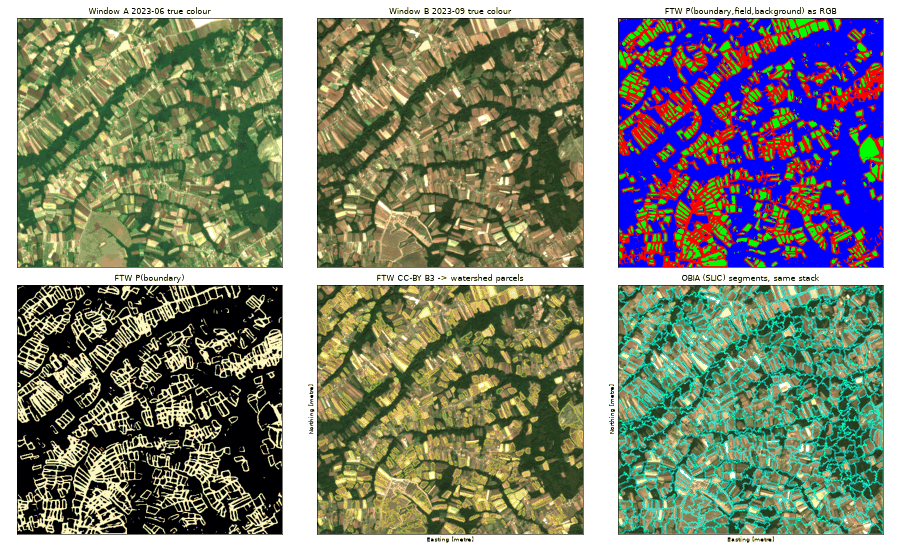

# Pretrained field boundaries (Fields of The World)

`geocrop ftw-boundaries` runs a pretrained field-boundary network from
[Fields of The World](https://fieldsofthe.world) (FTW) on GeoCrop Sentinel-2 composites and turns its output into
candidate parcel polygons with the existing watershed post-processing. It is also registered as the segmenter
`ftw` (`geocrop.segmenters`), so `benchmark-segmentation` scores it on the same metrics as OBIA and the U-Net.
It is an alternative to training the small GeoCrop U-Net when no local boundary labels exist; its output is
**not** a cadastral parcel and must be validated locally (see [Segmentation](segmentation.md#evaluation)).

## Licences and attribution

| Component | Licence | How GeoCrop uses it |
|---|---|---|
| FTW code (`ftw-baselines`, PyPI `ftw-tools`) | MIT | not required; input contract and checkpoint format re-implemented |
| CC-BY checkpoints (`*_CCBY`) | CC-BY-4.0 (trained on CC-BY/CC0 FTW data only) | **default**, commercial/agency use allowed with attribution |
| "FULL" / "Standard" checkpoints | trained on mixed licences incl. CC-BY-NC-SA | refused unless `--allow-noncommercial`; prints a licence warning |
| segmentation-models-pytorch | MIT | optional runtime dependency to build the network |
| Delineate Anything weights | AGPL-3.0 | not supported (would only be acceptable as an external process) |

Checkpoints are downloaded at runtime from the official FTW GitHub releases into a cache
(`$GEOCROP_FTW_CACHE`, else `$XDG_CACHE_HOME/geocrop/ftw` or `~/.cache/geocrop/ftw`); they are never bundled.
Each one is pinned by URL, size and SHA-256 in `geocrop.ftw.MODELS` (GitHub release-asset digests for v2, v3 and
v3.1; for v1, which publishes no digest, computed from the downloaded file) and loaded with
`torch.load(weights_only=True)`, so no pickled code is executed.

| Name (`--model`) | Release | Licence | Classes | Size |
|---|---|---|---|---|
| `FTW_PRUE_EFNET_B3_CCBY` (default) | v3.1 | CC-BY-4.0 | 3 | 53 MB |
| `FTW_PRUE_EFNET_B5_CCBY` | v3.1 | CC-BY-4.0 | 3 | 126 MB |
| `FTW_PRUE_EFNET_B7_CCBY` | v3.1 | CC-BY-4.0 | 3 | 270 MB |
| `FTW_v1_3_Class_CCBY`, `FTW_v1_2_Class_CCBY` | v1 (legacy) | CC-BY-4.0 | 3 / 2 | 204 MB |
| `FTW_PRUE_EFNET_B3`, `_B5`, `_B7`, `FTW_v2_3_Class_FULL_multiWindow` | v3 / v2 | mixed, non-commercial | 3 | 53–270 MB |

`geocrop ftw-boundaries --list-models` prints the full table with URLs and digests.

Products derived with an FTW model should credit: *Kerner, H. et al. (2025). Fields of The World: A Machine
Learning Benchmark Dataset for Global Agricultural Field Boundary Segmentation. AAAI 2025. arXiv:2409.16252*,
plus "contains modified Copernicus Sentinel data". `ftw_summary.json` records the model, licence and citation.

## Input contract

FTW networks take a **two-date** stack of 8 bands: window A (start of the growing season) then window B (end of
the season, before harvest), each in the order red, green, blue, NIR = `B04 B03 B02 B08`, at 10 m.
FTW inference divides Sentinel-2 L2A digital numbers of processing baseline < 04.00 by 3000. GeoCrop stores
reflectance in [0, 1] with the baseline ≥ 04.00 offset already removed, so the adapter feeds
`reflectance × 10000 / 3000`; nodata becomes 0 as in FTW. `build_stack` tags its output
(`GEOCROP_FTW_UNITS=reflectance`); a stack from `ftw inference download` (uint16 digital numbers) can be used with
`--stack ... --units dn`. Scaling is never guessed from pixel values.

Window folders are GeoCrop composites (`composites/<window>/`) or scene folders with `B02.tif … B08.tif`;
bands on a different grid are warped (bilinear) onto the study grid (`--grid`, default window A).

## Usage

```bash
# 1) real Sentinel-2 composites on the study grid (Semberija test area)
geocrop quicklook --bbox 19.10 44.72 19.16 44.76 --start 2023-03-01 --end 2023-10-31 --out work/semberija
# 2) download the default CC-BY checkpoint once (verified against its SHA-256)
geocrop ftw-boundaries --download-only
# 3) stack, blockwise CPU inference, watershed parcels (+ optional object metrics against reference parcels)
geocrop ftw-boundaries --window-a work/semberija/composites/2023-06 --window-b work/semberija/composites/2023-09 \
    --out work/semberija/ftw [--reference parcels_ref.gpkg]
```

Outputs in `--out`: `ftw_stack.tif` (8-band input), `ftw_probabilities.tif` (`p_background`, `p_field`,
`p_boundary`), `ftw_not_field.tif` (1 − P(field), the "boundary probability" fed to
`boundaries-to-parcels`), `ftw_parcels.gpkg`, `ftw_summary.json` and, with `--reference`, `segment_metrics.json`.

Inference is tiled (`--patch`, default 256 px) with an `--overlap` halo (default 32 px) on every side; only tile
centres are written, so tiles join without seams. Because FTW probabilities are nearly binary and boundaries
about two pixels wide, the FTW watershed seeds every interior pixel more than `--min-seed-distance` (1 px) from a
boundary (`--seed-percentile 0`); the generic defaults (55th percentile, 2 px) drop narrow strip fields.

In a benchmark (Python API, or `geocrop benchmark-segmentation --methods '<json>'`):

```bash
geocrop benchmark-segmentation --raster work/semberija/ftw/ftw_stack.tif --reference parcels_ref.gpkg --out bench \
    --methods '{"ftw_b3": {"segmenter": "ftw", "model": "FTW_PRUE_EFNET_B3_CCBY"}}'
```

The registered segmenter never downloads: the checkpoint must be in the cache (step 2) or given as `checkpoint`.

## Semberija run (2023)

Executed with the commands above on 2026-10-26 (macOS, Apple CPU, PyTorch 2.14, segmentation-models-pytorch
0.5.0). Earth Search returned no sufficiently clear acquisition for March–April 2023 over the area and a single
one for May (58 % of the grid valid), so window A is the June composite (3 acquisitions) and window B the September
composite (4 acquisitions).

| Step | Result |
|---|---|
| Grid | 486 × 456 px, EPSG:32634, 21.1 km² |
| FTW CC-BY B3 inference (4 tiles of 256 px, CPU) | 2.7–4.0 s; whole command incl. stacking and watershed ≈ 5–6 s |
| FTW parcels | 640 objects, 3.8 km², median 0.45 ha |
| OBIA on the same 8-band stack (default settings) | 581 objects, 2.7 s, covers the whole grid, median 3.1 ha |



Qualitatively (no reference parcels were used, so there are no accuracy numbers): FTW separates forest,
settlements and roads as background and its boundaries follow visible field edges, while OBIA partitions
everything, including forest, into superpixels that often straddle several strips. FTW predicts many of the very
narrow Semberija strip fields as "boundary" (about 30 % of the pixels), so those strips produce no object and
the parcel layer covers only part of the cropland. Whether B5/B7 or a different window pair do better here must
be measured against reference parcels.

## Limitations

* **Training domain.** The CC-BY checkpoints were trained on Austria, Brazil, Corsica, Denmark, Estonia, Finland,
  France, India, Luxembourg, Netherlands, Rwanda, Slovakia, Spain and Vietnam only; Croatia and Slovenia are in
  their *test* set and in the training set of the non-commercial FULL models only. Bosnia and Herzegovina is in
  neither. Small, narrow fields and mixed smallholder landscapes are a known failure mode.
* **Validate locally** with `evaluate-segments` / `benchmark-segmentation` against independent reference parcels
  before relying on outputs; the default watershed settings are not tuned on Bosnian data.
* **Window choice** matters: FTW expects start- and end-of-season images; a cloudy spring may force later windows
  (as above), which changes what the model sees.
* Only the two-window semantic models built with segmentation-models-pytorch (U-Net, UPerNet, DeepLabV3+) are
  supported; siamese (`fcsiam*`), single-window, PlanetScope (FTP) and instance-segmentation models are not.
* CPU inference is practical for municipalities; a whole country needs a GPU (`device` parameter) or patience.

Optional dependencies: `torch` and `segmentation-models-pytorch` (both installed lazily, MIT/BSD licensed).
