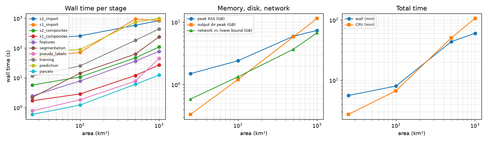

# Performance at scale (measured)

Engineering evidence for sizing: the real chain run on nested real areas of the Semberija plain (northern
Bosnia and Herzegovina, Republic of Srpska; grid EPSG:32634, 10 m), one season (2023-06-01 to 2023-09-30, four
monthly windows), with wall time, CPU time, memory, disk and network measured per stage. These numbers document
the engine; they are not results of the crop-mapping study.

```bash
pip install psutil matplotlib                     # measurement and plot dependencies of the tool only
PYTHONPATH=src python tools/scale_benchmark.py run --out outputs/scale --sizes 25 100 500 1000 --max-hours 3
PYTHONPATH=src python tools/scale_benchmark.py report --out outputs/scale --images docs/images
```

## What runs

Each area is a square centred at 364 000 E / 4 960 000 N (west of Bijeljina) and runs in its own process, so
that peak memory is per area:

grid → **Sentinel-2 L2A import** (Earth Search STAC, windowed COG reads, cloud filter 60 %, ≥ 50 % clear AOI) →
**Sentinel-1 RTC import** (Planetary Computer STAC, signed COGs, overpass mosaics) → S2 and S1 window composites
(S2 with 1 px mask dilation and temporal screening) → feature stack (97 features) → OBIA segmentation of the
peak-NDVI window (50 segments/km²) → **pseudo-labels** → Random Forest training (100 trees, 3 spatial folds,
calibration, conformal, AOA) → prediction (classes, probabilities, uncertainty, AOA map) → parcel analytics on
the segments.

**Labels are synthetic pseudo-classes** (k-means of per-segment NDVI trajectories, exactly as in
`geocrop acceptance`; 50 sampled pixels per training segment). They make training and prediction cost
realistic for this many polygons; **no accuracy is reported** and none should be inferred. Training cost depends
on the number of reference samples, not on area: with real reference polygons it is usually far smaller than here.

## How it is measured

A sampling thread records the process tree every 0.5 s. Per stage:

| Quantity | Method |
|---|---|
| Wall / CPU time | `time.perf_counter`; process CPU user + system incl. finished children (psutil); busy cores = CPU / wall |
| Peak RSS | sampled maximum of the process tree RSS (the process high-water mark is also stored) |
| Disk | allocated bytes (`st_blocks`) added to the output directory, and its peak size |
| Network in | **lower bound**: bytes received per TCP flow of this process from macOS `nettop`, sampled every 2 s (flows that open and close between samples are missed); **upper bound**: host interface counters (all traffic of the machine; marked n/a where a 32-bit counter wrapped) |
| Host load | 1-min load average and host CPU busy %, because other jobs inflate wall (not CPU) time |

MB/GB in the tables are binary (MiB/GiB). Machine: Apple M5 Pro laptop (15 cores, 48 GB RAM, internal NVMe SSD), macOS, Python 3.12; ordinary
broadband connection. **The host was shared** with other heavy jobs (the 25 km² run and the 500 km² training/prediction ran at 1-min
load 17–25 on 15 cores; the 1000 km² run mostly at 3–7): CPU seconds are reliable, wall seconds are pessimistic.

## Results



| Area km² | Grid Mpx | S2 / S1 scenes | Features | Train samples | Wall min | CPU min | Peak RSS GB | Output peak GB | Network in GB (lower–upper) |
|---|---|---|---|---|---|---|---|---|---|
| 25 | 0.25 | 14 / 38 | 97 | 28600 | 5.6 | 2.7 | 1.50 | 0.33 | 0.59–1.76 |
| 100 | 1.00 | 15 / 38 | 97 | 112500 | 8.0 | 6.7 | 2.41 | 1.20 | 1.34–1.93 |
| 501 | 5.01 | 15 / 38 | 97 | 551450 | 43.7 | 50.5 | 5.92 | 5.80 | 3.67–n/a |
| 1001 | 10.01 | 16 / 38 | 97 | 1159069 | 60.2 | 106.4 | 7.38 | 11.48 | 6.75–n/a |

All four areas completed (the 3 h cap was not reached; 1000 km² took 60 min). A first 1000 km² attempt hung for
more than an hour in the Sentinel-1 import on a dead HTTPS connection; GDAL had no HTTP timeout, which is fixed in
this release (connect/total timeouts and a low-speed abort, see CHANGELOG) and the area was re-measured from
scratch. Areas are the snapped grid extents; scene counts are acquisitions that passed the filters (S1: overpass
mosaics of both orbit directions; Sentinel-1B was not operating in 2023).

<details><summary>Per-stage measurements (all areas)</summary>

**25 km²** (grid 0.25 Mpx)

| Stage | Wall s | CPU s | Busy cores | Peak RSS MB | Disk written MB | Net in MB (lower–upper) | Host load (1 min) |
|---|---|---|---|---|---|---|---|
| grid | 0.08 | 0.06 | 0.69 | 222.8 | 0 | 0–0 | None |
| s2_import | 191.93 | 18.09 | 0.09 | 301.6 | 98.8 | 349.8–986.6 | 25.3 |
| s1_import | 46.49 | 7.6 | 0.16 | 276.5 | 59.8 | 249.7–328.4 | 21.6 |
| s2_composites | 5.73 | 4.2 | 0.73 | 467.4 | 28.8 | 0–36.3 | 21.7 |
| s1_composites | 1.7 | 1.04 | 0.61 | 503.9 | 6.1 | 0–15 | 22.4 |
| features | 2.47 | 2.27 | 0.92 | 703.9 | 80.5 | 0–6.7 | 22.4 |
| segmentation | 2.21 | 2.06 | 0.93 | 771.6 | 1.1 | 0–5.8 | 22.1 |
| pseudo_labels | 0.78 | 0.86 | 1.1 | 794.9 | 0.8 | 0–2.3 | 21.9 |
| training | 11.58 | 52.14 | 4.5 | 1122.6 | 56.9 | 0–28.9 | 22.8 |
| prediction | 70.62 | 73.95 | 1.05 | 1533.1 | 7 | 0–387.8 | 21.9 |
| parcels | 0.59 | 0.53 | 0.9 | 1167.2 | 1.7 | 0–7.4 | 22.2 |

**100 km²** (grid 1.00 Mpx)

| Stage | Wall s | CPU s | Busy cores | Peak RSS MB | Disk written MB | Net in MB (lower–upper) | Host load (1 min) |
|---|---|---|---|---|---|---|---|
| grid | 0.07 | 0.04 | 0.6 | 225.1 | 0 | 0–0.8 | None |
| s2_import | 255.97 | 34.23 | 0.13 | 366.2 | 422.3 | 821.8–1403.7 | 19.8 |
| s1_import | 71.53 | 15.78 | 0.22 | 368.1 | 237.3 | 545.4–572.3 | 13.3 |
| s2_composites | 10.7 | 9.85 | 0.92 | 681.9 | 122.7 | 0–0.1 | 8.1 |
| s1_composites | 2.87 | 2.42 | 0.84 | 700.9 | 24.2 | 0–0 | 7.6 |
| features | 7.82 | 7.58 | 0.97 | 1147.2 | 288 | 0–0.2 | 7.3 |
| segmentation | 14.24 | 14.12 | 0.99 | 1491 | 4.3 | 0–0.2 | 6.4 |
| pseudo_labels | 1.83 | 2.66 | 1.45 | 1173.2 | 3 | 0–0 | 5.8 |
| training | 25 | 214.81 | 8.59 | 1923.2 | 98.9 | 0–0.3 | 8.9 |
| prediction | 89.71 | 99.87 | 1.11 | 2467.5 | 26.4 | 0–1.3 | 6.9 |
| parcels | 1.22 | 1.17 | 0.96 | 2034.7 | 6.7 | 0–0 | 4.6 |

**501 km²** (grid 5.01 Mpx)

| Stage | Wall s | CPU s | Busy cores | Peak RSS MB | Disk written MB | Net in MB (lower–upper) | Host load (1 min) |
|---|---|---|---|---|---|---|---|
| grid | 0.07 | 0.04 | 0.55 | 234.1 | 0 | 0–0 | None |
| s2_import | 581.21 | 107.95 | 0.19 | 719.5 | 2103.8 | 1523.6–n/a | 2.0 |
| s1_import | 948.1 | 112.2 | 0.12 | 707.4 | 1183 | 2234.7–2357.1 | 1.6 |
| s2_composites | 46.74 | 46.2 | 0.99 | 1599.7 | 581.1 | 0–0.8 | 1.2 |
| s1_composites | 12 | 11.54 | 0.96 | 1617.7 | 123.6 | 0–0.2 | 1.2 |
| features | 36.3 | 36.68 | 1.01 | 3088.1 | 1424 | 0–0.6 | 1.2 |
| segmentation | 62.66 | 63.01 | 1.01 | 3583.5 | 21.9 | 0–1 | 1.7 |
| pseudo_labels | 7.76 | 8.65 | 1.11 | 3442 | 15.4 | 0–0.1 | 2.1 |
| training | 181.31 | 1789.1 | 9.87 | 6046.4 | 332.2 | 0–4.6 | 17.6 |
| prediction | 741.23 | 846.04 | 1.14 | 6067 | 121.5 | 0–1294.8 | 20.9 |
| parcels | 6.04 | 5.98 | 0.99 | 1859.8 | 33.8 | 0–51.8 | 6.6 |

**1001 km²** (grid 10.01 Mpx)

| Stage | Wall s | CPU s | Busy cores | Peak RSS MB | Disk written MB | Net in MB (lower–upper) | Host load (1 min) |
|---|---|---|---|---|---|---|---|
| grid | 0.09 | 0.05 | 0.54 | 239.8 | 0 | 0–0 | 30.1 |
| s2_import | 832.19 | 174.83 | 0.21 | 1121.7 | 4200.7 | 2371.8–n/a | 4.7 |
| s1_import | 838.31 | 141.15 | 0.17 | 1169.7 | 2373 | 4538.3–n/a | 2.9 |
| s2_composites | 108.33 | 106.19 | 0.98 | 2574.8 | 1142.8 | 0–125.4 | 3.6 |
| s1_composites | 27.09 | 25.69 | 0.95 | 2605 | 244.8 | 0–14.7 | 5.0 |
| features | 77.38 | 79.79 | 1.03 | 2885.1 | 2816 | 0–29.6 | 4.9 |
| segmentation | 238.27 | 238.95 | 1.0 | 3619.1 | 45.9 | 0–1726.7 | 4.5 |
| pseudo_labels | 45.15 | 48.19 | 1.07 | 3780 | 32.2 | 0–115 | 2.9 |
| training | 438.74 | 4312.62 | 9.83 | 7555.4 | 575.1 | 0–213.8 | 31.1 |
| prediction | 989.99 | 1246.99 | 1.26 | 6961 | 250.4 | 0–164.3 | 6.7 |
| parcels | 12.41 | 12.3 | 0.99 | 4012.9 | 70.6 | 0–0.4 | 3.6 |

</details>

### Observations

* **Imports are network-bound and sequential.** S2 and S1 imports use 0.2 busy cores and dominate small areas
  (latency) and stay ~45 % of wall time at 1000 km² (14 min each). Per 1000 km² and season they received at
  least 2.3 GB (S2) and 4.4 GB (S1) and wrote 4.1 GB and 2.3 GB of scene folders. Scene folders are the largest
  item on disk (56 % of the 11.5 GiB output at 1000 km²). Several import processes in parallel (one per
  tile/orbit or window) are the obvious speed-up on a VM with good bandwidth.
* **Compositing, features, segmentation and parcels run on one core** (busy cores ≈ 1.0); they scale linearly
  with area except **OBIA segmentation, which grew 3.8x from 500 to 1000 km²** (63 → 238 s, ~1 core, host
  quiet) after growing linearly up to 500 km² — the seam reconciliation over a single global segment list is the
  likely cause; for regional runs segment per tile/municipality (listed as an open issue).
* **Prediction is dominated by the area-of-applicability map**: a single-core nearest-neighbour search of every
  pixel among 20 000 training points in 97 dimensions (98 s of 101 s for 1 Mpx when timed separately; 99–148 s
  per Mpx across runs). The Random-Forest probabilities themselves take a few seconds per Mpx on all cores.
* **Training** (pseudo-labels: 50 pixels per segment, so samples grow with area — 1.16 M samples at 1000 km²)
  is the only stage using many cores (~10 busy) and the memory peak (7.4 GiB at 1000 km²). With real reference
  polygons the sample count is set by the reference data, not by the area.
* **Memory is modest**: peak RSS 1.5 → 7.4 GiB from 25 to 1000 km², of which ~1 GiB is interpreter/GDAL base.
  Window-wise compositing, features and prediction keep their working sets block-sized; the RSS values per stage
  include memory retained from earlier stages of the same process.
* **Disk** grows linearly: ~11.7 MiB per km² of output for this configuration (4 windows, S2 + S1, 97 features).

## Preflight estimator vs measurement

`geocrop preflight` estimates were computed for each measured layout (same grid, scenes, windows, features,
sample count) with the coefficients before and after the recalibration in this release (full table:
`outputs/scale/scale_tables.md` from the `report` command):

| Area km² | Predict s: before / after / measured | Peak RAM GB: before / after / measured | Composite s: estimate / measured | Stack GB: estimate / measured |
|---|---|---|---|---|
| 25 | 18 / 40 / 71 | 0.55 / 1.55 / 1.61 | 7.2 / 7.4 | 0.078 / 0.084 |
| 100 | 68 / 155 / 90 | 1.58 / 2.58 / 2.59 | 25 / 14 | 0.31 / 0.30 |
| 501 | 349 / 778 / 741 | 7.31 / 8.31 / 6.36 | 133 / 59 | 1.55 / 1.49 |
| 1001 | 702 / 1560 / 990 | 15.4 / 16.4 / 7.92 | 274 / 135 | 3.11 / 2.95 |

* Disk estimates (composites, stack, prediction) were within ±15 % at every size — no change needed.
* **Prediction runtime was under-estimated up to 4x** (2.1x at 500 km²) because the AOA map was not modelled. The
  estimate now adds 150 s per Mpx per 100 features for it; it is within 0.6–1.8x of the measurements (the 25 km²
  value was measured on a host with load ~22).
* **Peak RAM was under-estimated ~3x for small areas** (no interpreter/GDAL base). ~1 GB is now added per stage.
  At large sample counts the training estimate (upper bound for the Random-Forest size) is ~2x conservative.
* Composite, feature and training runtimes are conservative by 1.0–2.7x; they are left unchanged because they
  are upper bounds on a busier machine. Scene import (network) is not estimated by preflight; use the rates below.

## Extrapolation to the 25-municipality region

Assumptions (state them with any number you quote): **AOI ≈ 10 000 km²** (the planning figure of
[deployment](deployment.md); rasters cover the full grid rectangle, which for a 16.3–19.3 E band can be about
twice the AOI — the right-hand column), **one season, 4 windows**, the same chain and inputs as measured (S2 + S1,
97 features, no time-series features or embeddings), the per-km² rates of the 1000 km² run, linear scaling except
where noted, the same laptop-class CPU and connection, everything run sequentially in one process per stage.

| Item | per 1000 km² (measured) | 10 000 km² | 20 000 km² (grid rectangle) |
|---|---|---|---|
| S2 import (sequential) | 14 min, ≥ 2.3 GB in, 4.1 GB on disk | 2.3 h, ≥ 23 GB, 41 GB | 4.6 h, ≥ 46 GB, 82 GB |
| S1 RTC import (sequential) | 14 min, ≥ 4.4 GB in, 2.3 GB on disk | 2.3 h, ≥ 44 GB, 23 GB | 4.7 h, ≥ 89 GB, 46 GB |
| Composites + features | 3.5 min, 4.1 GB | 35 min, 41 GB | 1.2 h, 82 GB |
| OBIA segmentation | 4 min | 0.7 h if linear; up to ~6 h at the 500→1000 km² growth rate (segment per tile) | 1.3 h linear |
| Prediction incl. AOA | 16.5 min | 2.8 h (single core) | 5.5 h |
| Training | depends on reference samples, not area: 1.16 M samples → 7.3 min on 10 cores, 7.4 GiB | – | – |
| **Total wall time (excl. training)** | ~52 min | **~9 h (linear) to ~14 h** | ~17 h (linear), more with segmentation growth |
| **Peak disk** (scenes + derived) | 11.5 GiB | **~115 GiB** | ~230 GiB |

Three seasons (2023–2025) multiply imports, composites, features and prediction by three (~30–40 h, ~350 GiB at
10 000 km²); a longer season with more windows (the case-study config uses 4 windows over April–October plus
time-series features) adds scenes and features roughly in proportion. These are planning figures from four
measured points on one machine, not guarantees.

## VM sizing

Cross-checked against [deployment](deployment.md) and the recalibrated preflight:

| Use | vCPU | RAM | Disk (fast scratch) | Network | Measured basis |
|---|---|---|---|---|---|
| Pilot ≤ 1 000 km², one season | 8 | 16–32 GB | 100 GB NVMe (+ archive) | ≥ 100 Mbit/s | 1000 km² run: 7.4 GiB peak, 11.5 GiB output, 60 min on a shared 15-core laptop |
| Region ~10 000 km², one season | 16 | 64 GB | 500 GB–1 TB NVMe | ≥ 500 Mbit/s, parallel imports | extrapolation above: ~115 GiB per season, 9–14 h sequential |
| Region, three seasons kept online | 16 | 64 GB | 1–2 TB NVMe + archive | as above | ~350 GiB of scenes and products |

* The measurements confirm the deployment table (8 cores / 32 GB pilot; 12–16 cores / 64 GB regional) and show
  it is **not memory-bound**: 64 GB leaves room for regional training sets (a few million samples) and for
  running 3–4 imports or tiles in parallel. 128 GB is only needed for many parallel SNAP jobs (not used here:
  Sentinel-1 RTC comes pre-processed from Planetary Computer).
* The deployment table's 2 TB scratch for one regional season is generous for this chain (~115–230 GiB); keep it
  if SAFE downloads/SNAP processing or time-series features are used. Keep 20–25 % free space.
* The wall-time levers are I/O parallelism (imports) and the single-core AOA and segmentation stages, not more
  RAM or a GPU. More cores help training and parallel tiles; a GPU is not needed for this chain.
* Run `geocrop preflight` on the real configuration before a regional run; its disk figures matched within
  ±15 % here and its runtime/RAM figures are now conservative upper bounds.

