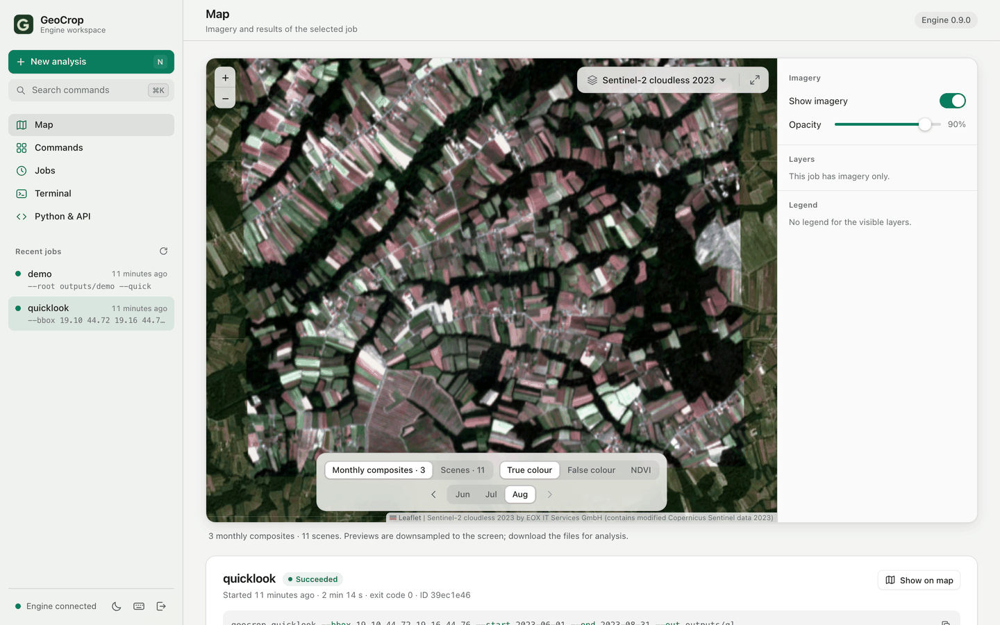

# HTML workspace, HTTP jobs and Jupyter

The web extra adds a local interface around the existing engine CLI. All existing CLI commands and
Python functions remain available. No frontend build service, Node runtime, external fonts or CDN is
needed. HTML/CSS/JavaScript are shipped inside the Python package.



The screenshot shows a monthly true-colour composite from `geocrop quicklook` (contains modified Copernicus
Sentinel data 2023); it is imagery for orientation, not a crop-accuracy result.

## Start the workspace

```bash
pip install -e '.[web]'
# Set a random token of at least 32 characters in your terminal/environment.
# Keep its value out of source files, notebook outputs and Git.
export GEOCROP_WEB_TOKEN=...  # enter your token locally
geocrop serve --workspace /path/to/your/study --port 8765
```

Open the local server on port 8765 in your browser and enter the same token. The command binds to
loopback only. A notebook on another machine can use an SSH-forwarded local port. This is a single
trusted owner's research tool running as that owner's account, not a public/multi-tenant service or
a security sandbox for untrusted model files. Inputs, configs and joblib models must be trusted.

## First steps: from an area and dates to imagery

The workspace opens on the **Map**. With no job selected it offers three ways in:

1. **New analysis** (or press <kbd>N</kbd>) opens a three-step sheet:
   *Area* — type a bounding box in degrees (WGS 84), use the Semberija example, or choose **Draw on map** and drag a
   rectangle (or click/tap two corners; <kbd>Esc</kbd> cancels); *Period* — start and end dates or a preset such as
   the latest growing season; *Run* — review the area size, the period and a fresh output folder. The sheet shows the
   exact `geocrop quicklook ...` command it submits, so the same run can be repeated in a shell or notebook.
2. **Try Semberija, Jun–Aug 2023** submits that quicklook with one click.
3. **Run the synthetic demo** is a software check that produces crop classes, uncertainty and parcels.

While a job runs, the map shows its progress and the output streams below the map. When it finishes, a
notification appears and the imagery is drawn on the map. The *imagery bar* at the bottom of the map switches between
monthly composites and single scenes, between true colour, false colour and NDVI, and steps through the dates
(<kbd>[</kbd> and <kbd>]</kbd>). The side panel holds the imagery switch and opacity, a switch per result layer and
the legend. The expand button (or <kbd>F</kbd>) shows the map full-window.

## Views

* **Map** — imagery and results of the selected job, its output log and its files (with type and size; click to
  download).
* **Commands** — every engine command as a form generated from the actual CLI parser, grouped by purpose and
  filterable. Required inputs come first; optional settings sit under *Advanced options*. The live *Command line*
  preview omits unchanged defaults, so it is exactly what one would type.
* **Jobs** — the persistent job history with status, relative start time, duration and exit code;
  queued/running/succeeded/failed/cancelled/interrupted states, incremental logs and cancellation.
* **Terminal** — a macOS-style engine console with syntax colouring, completion and history (see below).
* **Review** — walk the parcels of a finished parcel job one by one and record analyst decisions (see
  [Review](#review-analyst-parcel-decisions) below).
* **Python & API** — Jupyter/Python and HTTP examples and an authenticated OpenAPI schema download.

The sidebar lists recent jobs; on a phone the views move to a bottom tab bar. Light and dark appearance follow the
system; the moon/sun button overrides it (remembered in this browser only).

### Keyboard shortcuts

| Keys | Action |
|---|---|
| <kbd>⌘K</kbd> / <kbd>Ctrl K</kbd> | command palette: search commands and actions |
| <kbd>N</kbd> | new analysis |
| <kbd>1</kbd>–<kbd>6</kbd> | Map, Commands, Jobs, Terminal, Review, Python & API |
| <kbd>F</kbd> | expand or restore the map |
| <kbd>[</kbd> / <kbd>]</kbd> | previous / next imagery date |
| <kbd>J</kbd> / <kbd>K</kbd> | next / previous job; in Review: next / previous parcel |
| <kbd>A</kbd> / <kbd>D</kbd> / <kbd>U</kbd> | Review: agree, disagree (then pick the class, <kbd>↵</kbd> saves), can't tell |
| <kbd>?</kbd> | shortcut overview |
| <kbd>Esc</kbd> | close a sheet, cancel area drawing or leave the expanded map |

Single-key shortcuts are ignored while typing in a field or the terminal.

The console invokes `python -m geocrop.cli` with an argument list, never a shell. `serve`, direct SNAP
executable invocation and `manifest --snap-gpt` are unavailable in the web console; use the ordinary
CLI when those external programs are needed. Shell operators, arbitrary Python, environment assignments
and `cd` are not console commands. All jobs use the chosen workspace as their working directory.

One worker executes jobs sequentially. Job state/logs live in `<workspace>/.geocrop-web` by default;
`--state-dir` changes that location. On POSIX an advisory lock prevents two servers sharing it.
Queued/running records found after restart are marked interrupted rather than replayed. Normal shutdown
stops the active process group; after an abrupt machine/process failure, inspect any surviving child
processes before manually rerunning an interrupted job. Cancellation can leave partial engine outputs;
they are retained for inspection and the engine's own pipeline resume rules still apply.

On POSIX each job runs as `python -c <bootstrap> <workspace> <args>` started with `posix_spawn` in its own
session (stdin `/dev/null`, stdout and stderr to the job log). The server never forks: map previews load PROJ,
whose fork handler could crash a forked child before it started the job (jobs then exited with -11).

Job outputs must stay beneath the workspace and outside the web state directory. A config-driven `run`
also checks `paths.output`, `paths.features` and `paths.composites`. Inputs may reference accessible local
data. Choose fresh output paths for new experiments; the underlying engine retains its documented
overwrite/resume behavior when existing output paths are explicitly chosen. No project files or existing
commands are removed by installing the interface.

`GEOCROP_WEB_THREADS` sets OpenMP/OpenBLAS threads per job (default 2); the model's `n_jobs` setting remains
independent. The server access token is removed from child-job environments. The UI holds it only in
page memory, not URLs or browser local storage. Every API request requires Bearer authentication;
cross-origin browser requests are rejected and every response carries a strict content-security policy and
related headers (see [security](security.md)). Artifact downloads are attachments, and listings are
limited to the first 200 files within a job's declared output locations. Use local filesystem tools
for larger output inventories.

## Review: analyst parcel decisions

The **Review** view (<kbd>5</kbd>) turns a finished parcel job into a review queue, in the spirit of the
expert-judgement tools used in checks by monitoring (ideas only; no code from those projects is used). Select the
job in the sidebar — `geocrop demo`, `geocrop run` with parcels, `geocrop parcels` or `geocrop traffic-light` —
and open Review. Jobs without a parcel layer (for example a quicklook, which holds imagery only) show what is needed
instead.

* **Queue** — filter by traffic light, review state (to review / reviewed / all), declared class, reason code,
  uncertainty (ambiguous conformal set, confidence below 0.6 or 0.8) and, when the layer has several values, the
  model decision; sort by priority (red → yellow → grey → green, then lowest confidence), confidence, entropy,
  margin, area or id; search by parcel id. <kbd>J</kbd>/<kbd>K</kbd> move through the queue.
* **Parcel card** — declared vs predicted class, confidence and conformal prediction set, reason codes as pills
  (declaration, traffic-light, model-decision and evidence codes), mean class probabilities, the parcel outlined on
  the map (the same Leaflet map and basemaps as the Map view; clicking another parcel on the map opens it), the
  markers (`cbm` phenology and `cbm_markers` event columns found in the layer or in marker tables of the job) and
  every attribute.
* **Time series** — inline SVG, one panel per sensor (Sentinel-2 indices; Sentinel-1 VV/VH/VH−VV in dB) with
  observed points, ±1 standard deviation for a single series, ticks for acquisitions without valid pixels and a
  hover read-out. The series come from signature tables (`geocrop signatures` / `s1-signatures`, CSV or Parquet)
  found in the job's outputs, else from an evidence package; without either the view computes parcel means of NDVI and S1 backscatter from the job's
  composites or scene folders. Signatures produced by another job can be passed as evidence
  (`evidence=<job id>` on the API).
* **Image chips** — true colour or NDVI crops around the parcel for every composite window or scene date, with the
  parcel outline. One percentile stretch is shared by all dates of a parcel so brightness is comparable; dates with
  little valid data are dimmed and labelled. Chips are downsampled (at most 256 px) and cached in the web state
  directory (`<state>/review-cache/<job id>/`), never in the job's outputs.
* **Evidence packages** — when the job's outputs (or an evidence job) contain `geocrop evidence` packages
  (`<parcel>/evidence.json` with schema `geocrop-parcel-evidence`), the card adds the rules the package records as
  triggered to the reason pills and offers the package page as a download (it is never rendered inside the
  workspace). Without signature tables, the package's observed and rejected acquisitions and its interpolated curve
  become the time series.

### Decisions

<kbd>A</kbd> agrees with the predicted class, <kbd>D</kbd> opens the class picker (the declared class is
preselected when it differs from the prediction; *Other class…* accepts a new name) and <kbd>U</kbd> records
*can't tell*. Each decision states its **purpose** — *Training* or *Validation* — explicitly; the choice and the
analyst name are remembered in this browser only. Decisions are appended to `<job output>/review/decisions.csv`
(beside a single-file output: `<stem>_review/decisions.csv`); earlier rows are never edited and the latest row per
parcel counts:

| column | content |
|---|---|
| `timestamp_utc` | ISO 8601 time in UTC |
| `parcel_id`, `decision`, `label` | `agree` (label = predicted class), `disagree` (label = corrected class), `unsure` (empty label) |
| `predicted_class`, `declared_class` | as shown when the decision was made |
| `analyst`, `comment` | free text, one line; values starting with `=`, `+`, `-`, `@` are prefixed with `'` so spreadsheets do not run them |
| `purpose` | `training` or `validation` |
| `confidence` | optional analyst confidence 0–1 (API) |
| `model_sha256` | the model hash from `prediction_manifest.json` (or the conformal calibration record) |
| `parcels_layer` | workspace-relative path of the reviewed layer |

**Export labels** writes `review/labels_<purpose>[_round<k>].csv` with exactly the columns read by
[`geocrop active-learning ingest`](active-learning.md) (`parcel_id, label, source, date, confidence, purpose,
observer, notes, al_round`; `source=analyst`, one row per parcel and analyst) and shows the next command:

```bash
geocrop active-learning ingest --labels outputs/demo/review/labels_training_round1.csv \
    --parcels outputs/demo/parcels/parcels.gpkg --training data/reference/training.gpkg \
    --out data/reference/training_r1.gpkg --round 1
```

Validation exports are kept apart for the accuracy assessment and are never offered for training. Analyst
decisions concentrate on doubtful parcels: they are labels for the active-learning loop, **not** a probability
sample, and must not be used to estimate map accuracy or area.

### Review API

All routes need the Bearer token and are also served under `/api/v1`. Clients never send file paths: a layer is
chosen by its workspace-relative name among the layers found in the job, extra evidence by job id, and downloads
by fixed file names inside the review folder. Every file read comes from the job's declared outputs after
resolving symbolic links; the review folder and the decision log are refused when they are symbolic links or
resolve outside the workspace.

| route | purpose |
|---|---|
| `GET /api/v1/jobs/{id}/review` | layers, facets (filter values with counts), progress, model hash, evidence sources |
| `GET /api/v1/jobs/{id}/review/parcels` | queue page: `traffic_light`, `declared_class`, `decision`, `reason` (comma-separated), `max_confidence`, `min_set_size`, `review=all\|pending\|done`, `q`, `sort`, `order`, `offset`, `limit` |
| `GET /api/v1/jobs/{id}/review/parcel?id=` | parcel detail, markers, reason codes, series, WGS 84 outline, decision history |
| `GET /api/v1/jobs/{id}/review/chips?id=&kind=true\|ndvi&size=` | chips as PNG data URLs with outline and valid share |
| `POST /api/v1/jobs/{id}/review/decisions` | `{parcel_id, decision, purpose, label?, analyst?, comment?, confidence?}` |
| `GET /api/v1/jobs/{id}/review/evidence?id=&format=html\|json` | download the parcel's evidence package page or record |
| `GET /api/v1/jobs/{id}/review/decisions` | latest decision per parcel |
| `POST /api/v1/jobs/{id}/review/export` | `{purpose, round?}` → label table in the review folder |
| `GET /api/v1/jobs/{id}/review/file?name=` | download `decisions.csv` or an exported `labels_*.csv` |

Limitations: one parcel layer is loaded into memory per request cache (fine for tens of thousands of parcels;
national layers should be reviewed in subsets); chips need S2 bands `B02`, `B03`, `B04`, `B08` in composite or scene
folders of the job; the screenshots in the tests use the synthetic demo, which is a software check, not evidence of
accuracy.

## CLI console (terminal)

The **CLI console** tab is a macOS Terminal-style session. Type an engine command with or without the
leading `geocrop` (`indices --format markdown` and `geocrop indices --format markdown` are equivalent) and
press Enter. The job's output streams inline; a closing line shows `✓` (green) or `✗` (red) with the exit
code, duration and job ID. A started job is also selected in the *Command output* card, so its files and
map layers are available there.

While typing, the line is coloured: command names, known flags, numbers, quoted strings, paths and valid
choices each have their own colour; unknown commands, unknown flags, invalid choices and shell operators
are underlined in red. A hint line under the prompt lists the command's required flags (✓ provided /
● still missing) and the help, choices and default of the flag being edited.

Completion works like an editor's suggestion list: command names with descriptions; then the command's
flags with help, default and a *required* marker (flags already used are hidden unless they accept several
values); then `choices` of the current flag; and workspace paths for path-like flags (`--out`, `--root`,
`--config`, `--samples`, `--raster`, …). Paths come from `GET /api/files?prefix=<relative prefix>`, which
lists at most 200 entries of one workspace directory. It rejects absolute paths and `..`, never lists
hidden dot-files or the web state directory, and drops symlinks resolving outside the workspace. The top
suggestion (or the latest matching history entry) is shown as grey ghost text.

Built-in commands run in the browser and are not sent to the engine: `help` / `?` (all commands;
`help <command>` lists its flags), `clear`, `history` and `jobs` (recent jobs and their status). The last
100 commands are kept in the browser's local storage (the access token is never stored).

| Key | Action |
|---|---|
| Enter | run the line (accepts the highlighted suggestion while completing a partly typed word) |
| Tab | accept the suggestion; opens the list when it is closed (a single match is inserted directly) |
| Ctrl+Space | open the suggestion list |
| ↑ / ↓ | move in the suggestion list; with the list closed, previous/next history entry |
| → or End (at end of line) | accept the ghost-text hint |
| Esc | close the suggestion list |
| Ctrl+R | reverse history search (Ctrl+R again: older match, Enter: run, Esc: cancel) |
| Ctrl+C | cancel the running job (prints `^C`); without a job, discard the current line |
| Ctrl+L | clear the screen |
| Ctrl+U | delete text before the cursor |

The console still runs engine commands only, as an argument list and never through a shell.

## Jupyter Notebook / JupyterLab / Python

The client uses `requests`, already a core dependency; only the server needs the web extra. Install
the engine in the notebook kernel's Python environment and set `GEOCROP_WEB_TOKEN` there securely.

```python
from geocrop.client import EngineClient

with EngineClient() as engine:  # default endpoint: local port 8765; token from environment
    job = engine.submit(["indices", "--format", "json"])
    done = engine.wait(job["id"], timeout=60)
    print(engine.logs(job["id"])["text"])
```

For a full software check, submit `['demo', '--root', 'outputs/my-new-demo', '--quick']`. This is synthetic
verification, not a measurement of real crop accuracy. A remote/fowarded endpoint can be passed as
`EngineClient(base_url=...)`. Paths in submitted commands belong to the **server workspace**, not the
notebook machine. `engine.artifacts(job_id)` lists available files; `engine.download(job_id, path,
destination)` streams into a new local file and refuses to replace an existing destination.

`wait(..., check=True)` raises for failed/cancelled/interrupted jobs. `check=False` returns their status
and exit code for inspection; a timeout does not cancel the job. `logs(job_id, offset=...)` returns text
plus a byte `next_offset` for incremental reading. `cancel(job_id)` explicitly requests cancellation.
See the runnable [example notebook](../examples/web_notebook.ipynb); it contains no token or saved results.

## HTTP API

**`/api/v1` is the stable REST contract.** Its paths, parameters, response fields and status codes follow the
[versioning policy](release.md): within 1.x they only gain optional parameters, fields and endpoints. Every
endpoint is also served without the version segment (`/api/health`, `/api/jobs`, ...) as a **compatibility
alias** with identical behaviour, used by the bundled UI and older clients; new integrations should use
`/api/v1`. The OpenAPI schema lists the `/api/v1` paths only. `EngineClient` uses `/api/v1` and falls back to
the unversioned paths when talking to a server older than this contract (`EngineClient(api_prefix="/api")`
pins a prefix).

All endpoints below require `Authorization: Bearer <token>`:

| Method | Path | Purpose |
|---|---|---|
| GET | `/api/v1/health` | version, workspace and worker count |
| GET | `/api/v1/commands` | actual parser command/argument catalogue |
| POST | `/api/v1/jobs` | submit `{"argv": ["indices", "--format", "json"]}` or `{"command": "geocrop indices"}` |
| GET | `/api/v1/jobs` | newest jobs; `limit` defaults to 50, maximum 200 |
| GET | `/api/v1/jobs/{id}` | status, times, args, outputs and exit code |
| GET | `/api/v1/jobs/{id}/logs` | byte `offset` and bounded `limit` (up to 262144) |
| POST | `/api/v1/jobs/{id}/cancel` | stop a queued/running job |
| GET | `/api/v1/jobs/{id}/artifacts` | up to 200 local output files |
| GET | `/api/v1/jobs/{id}/artifact?path=...` | download a listed artifact |
| GET | `/api/v1/files?prefix=...` | up to 200 workspace entries for path completion (relative prefix only) |
| GET | `/api/v1/jobs/{id}/map` | map-ready previews of the job's outputs (see below) |
| GET | `/api/v1/openapi.json` | machine-readable API description |

Submission returns HTTP 202 and a job ID, not the final engine result. HTTP 400 reports invalid commands,
output locations or a full job queue (32 queued jobs), 401 missing/incorrect authentication, 403 cross-origin
requests, 404 unknown jobs/artifacts/paths and 413 request bodies over 1 MiB. Typed request validation can
return 422. Job arguments are limited to 256 items, 64 KiB each and 128 KiB in total. A job with engine exit
code 0 succeeds; any other code is recorded as failed, including audit/readiness commands that intentionally
use nonzero exit codes to report data problems. Use the logs to distinguish those outcomes.

For developers: routes are registered once under `/api/...` in `geocrop.web.create_app`; the final
`add_versioned_aliases(app)` call adds the `/api/v1/...` twin of every route registered before it, so a new
endpoint needs no separate versioned definition. Authentication is enforced for every `/api` path by
middleware as well as by the per-route dependency. The protections, their limits and the threat model are
described in [security](security.md).

## Results map
Selecting a succeeded job loads its spatial outputs on the **Map** (`GET /api/v1/jobs/{id}/map`):

| Layer | Source | Default |
|---|---|---|
| Crop classes | `classes.tif` + `class_legend.json` | on |
| Parcels — traffic light | parcel results with `traffic_light` (outline colour green/yellow/red/grey, popup with declared/predicted class, status and confidence) | on |
| Max class probability, normalised entropy | `uncertainty.tif` bands 1 and 3 | off |
| Inside area of applicability | `aoa.tif` band 2 | off |
| Other vector outputs (segments, reference layers, observations) | `.gpkg` / `.geojson` | off |
| Satellite imagery: true colour (B4-B3-B2), false colour (B8-B4-B3), NDVI | every window composite and scene folder of the job | latest cloud-free composite (true colour) when the job has no classification |

Imagery is chosen with the imagery bar (composites or scenes, product, date) and the side panel (on/off, opacity), so
only one image is drawn at a time.

### Real imagery in two minutes
```bash
geocrop quicklook --bbox 19.10 44.72 19.16 44.76 --start 2023-04-01 --end 2023-09-30 --out outputs/semberija-2023
```
reads only the area of interest from public Sentinel-2 L2A COGs (no account needed), keeps acquisitions with at
least 30 % clear pixels in the area, builds monthly cloud-screened composites and shows them on the map. The same
command is available in the web workspace.

### Basemaps
None (default), Sentinel-2 cloudless 2023 / 2024 (EOX IT Services GmbH, contains modified Copernicus Sentinel data,
CC BY-NC-SA 4.0 — non-commercial use) or OpenStreetMap. Enabling a basemap sends tile requests for the viewed area to
the provider.

Rasters are warped to WGS 84 and downsampled (≤ 1024 px) into PNG previews; vectors are simplified and capped at
20,000 features. Previews are for orientation only — download the files for analysis. Leaflet is bundled with the
package (no CDN).
